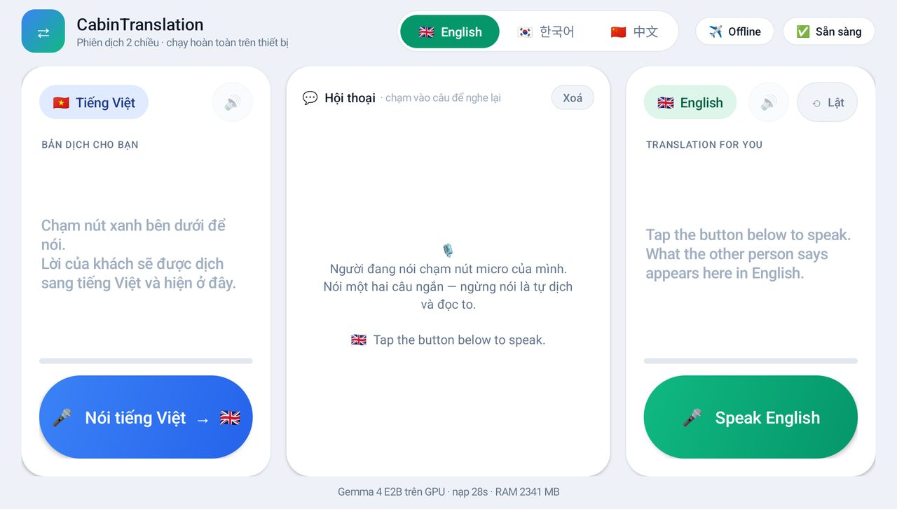
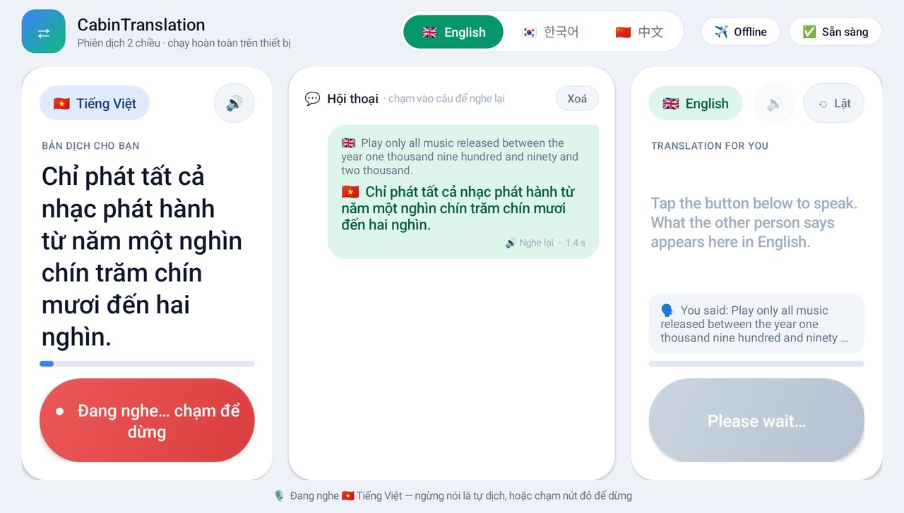
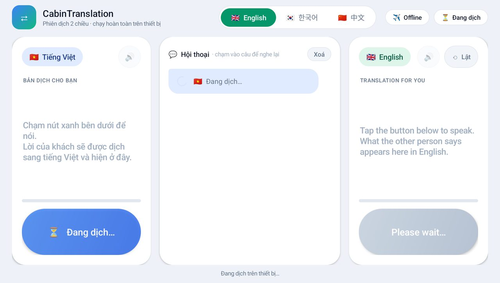
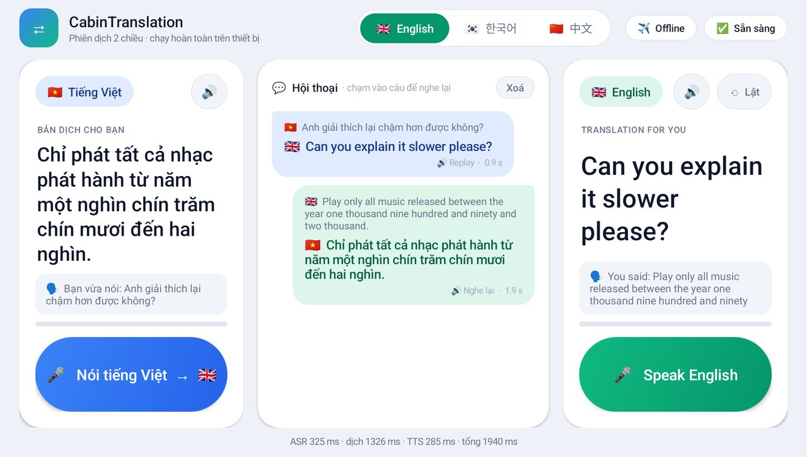
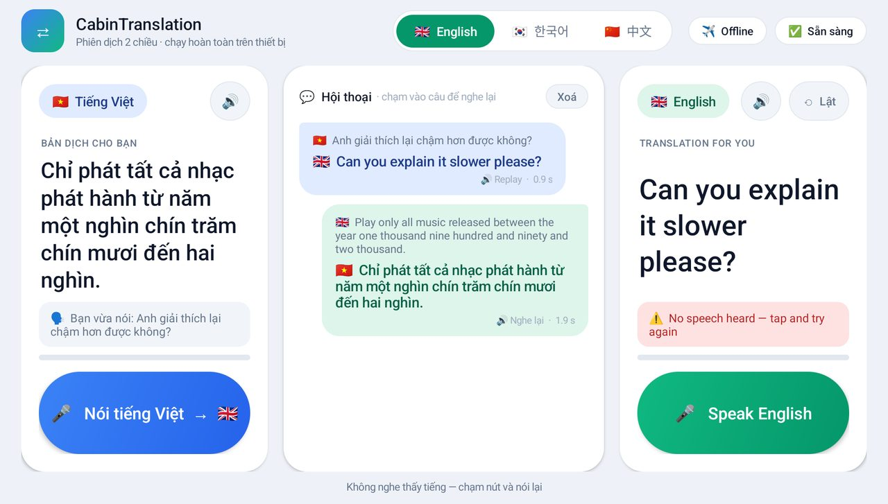

# CabinTranslation — install and use guide (v1.1)

CabinTranslation is an **offline two-way voice interpreter** for **Vietnamese ⇄ English, Korean and Chinese**.
You speak, the device recognizes the sentence, translates it with Gemma 4 E2B and reads the translation aloud.
Everything runs on the device itself. **No internet connection is needed or used.**

Team BKMEETING · OneVoice AI Challenge 2026 · Phase 3 prototype.

---

## Contents

1. [Which option should I use?](#1-which-option-should-i-use)
2. [Downloads](#2-downloads)
3. [Option A — Android tablet or phone](#3-option-a--android-tablet-or-phone)
4. [Option B — Arduino VENTUNO Q board](#4-option-b--arduino-ventuno-q-board)
5. [How to hold a conversation](#5-how-to-hold-a-conversation)
6. [Option C — PC reference app (developers)](#6-option-c--pc-reference-app-developers)
7. [Troubleshooting](#7-troubleshooting)
8. [What changed in v1.1](#8-what-changed-in-v11)
9. [Licenses](#9-licenses)

---

## 1. Which option should I use?

| You have… | Use | Time to set up |
|---|---|---|
| An Android tablet or phone with a Snapdragon chip (e.g. the QCS8550 meeting tablet, Galaxy S25 Ultra) | **Option A**: the Android app | 10–20 min (mostly copying 2.9 GB of models) |
| An Arduino VENTUNO Q board (Qualcomm QCS8275) | **Option B**: the board package + browser UI | 15–30 min |
| A Linux PC and you are a developer | Option C: the Python reference app | 30+ min |

Already installed **v1.0**? Updating is quick:
- Android: install the new APK only (Section 3.4, "Update from v1.0"). Your models stay where they are.
- VENTUNO Q: replace one file (Section 4.5).

---

## 2. Downloads

All files are on the GitHub **Releases** page of this repository, release **v1.1**. Everything needed is in this one
release.

| File | Size | What it is |
|---|---|---|
| `CabinTranslation-QCS8550-v1.1.tar.part-00` + `.part-01` | 1.9 GB + 1.0 GB | **Option A (Android):** the app v1.1 + all models + `install.sh` + this guide |
| `CabinTranslation-VentunoQ-v1.1.tar.part-00` + `.part-01` | 1.9 GB + 1.5 GB | **Option B (VENTUNO Q):** the complete board package with the v1.1 UI |
| `qairt-2.50-libs.tar` | 106 MB | Option B: Qualcomm NPU runtime libraries (kept separate: Qualcomm license) |
| `CabinTranslation-v1.1.apk` | 27 MB | The Android app alone, to **update** a device that already has v1.0 (Section 3.4) |
| `cabin-web-ui-v1.1.html` | 33 KB | The browser UI alone, to **update** a VENTUNO Q board that already has v1.0 (Section 4.5) |
| `README_INSTALL_QCS8550.md`, `README_INSTALL_VentunoQ.md` | — | Short install notes of each package (also inside the packages) |
| `INSTALL_AND_USE.md` | — | This guide |
| `BKMEETING_Prototype_Submission_V3.docx` | — | Submission document |
| `SHA256SUMS.txt` | — | Checksums of all files above and of the joined packages |

For a **new install** you only need the package of your device (plus `qairt-2.50-libs.tar` for VENTUNO Q).

GitHub limits one file to 2 GB, so the big packages are split into two parts. Join them back as shown below.

### 2.1 Join the parts and check them

**Windows** (Command Prompt, in the folder where you downloaded the files):

```bat
copy /b CabinTranslation-QCS8550-v1.1.tar.part-00 + CabinTranslation-QCS8550-v1.1.tar.part-01 CabinTranslation-QCS8550-v1.1.tar
certutil -hashfile CabinTranslation-QCS8550-v1.1.tar SHA256
tar -xf CabinTranslation-QCS8550-v1.1.tar
```

**Linux / macOS** (Terminal):

```bash
cat CabinTranslation-QCS8550-v1.1.tar.part-00 CabinTranslation-QCS8550-v1.1.tar.part-01 > CabinTranslation-QCS8550-v1.1.tar
sha256sum CabinTranslation-QCS8550-v1.1.tar        # macOS: shasum -a 256 CabinTranslation-QCS8550-v1.1.tar
tar -xf CabinTranslation-QCS8550-v1.1.tar
```

The checksum must match the line for that file in `SHA256SUMS.txt` (download it from the same release page).
It lists the joined `.tar` files as well as every part.

If it does not match, a download was incomplete. Check the parts against `SHA256SUMS.txt` and download the bad one again.

For the VentunoQ package, use the same commands with `VentunoQ` in place of `QCS8550`.

---

## 3. Option A — Android tablet or phone

### 3.1 Requirements

| Item | Requirement |
|---|---|
| Device | Android **10 or later**, 64-bit ARM. A **Qualcomm Snapdragon** chip with an Adreno GPU is needed: the translation model runs on the GPU. |
| Tested on | QCS8550 meeting tablet (Android 13, Adreno 740) and Samsung Galaxy S25 Ultra (Android 17, Adreno 830) |
| Memory | 8 GB RAM or more (the app uses about 2.3 GB while running) |
| Storage | **4 GB free** (the models take 2.9 GB) |
| Computer | Any Windows, macOS or Linux computer with a USB cable, to copy the files once |

### 3.2 Prepare the files

Download and join `CabinTranslation-QCS8550-v1.1.tar` and extract it (Section 2.1). You get a folder
`CabinTranslation-QCS8550-v1.1/` with:

| Item | What it is |
|---|---|
| `CabinTranslation.apk` | The app, version 1.1 |
| `models/` | All models, 2.9 GB |
| `install.sh` | One-command install (Linux/macOS) |
| `README_INSTALL.md`, `INSTALL_AND_USE.md` | Short notes and this guide |

The `models/` folder must contain exactly these 9 items:

```
Zipformer-30M-RNNT-6000h/
gemma-4-E2B-it-gpu.litertlm          (2,340,870,772 bytes)
matcha-icefall-zh-baker/
sherpa-onnx-supertonic-tts-int8-2026-03-06/
sherpa-onnx-x-asr-zipformer-transducer-zh-en-punct-int8-2026-06-03/
sherpa-onnx-zipformer-korean-2024-06-24/
vifasttts-ngochuyen-small/
vits-piper-en_US-lessac-medium/
vocos-22khz-univ.onnx
```

There are two ways to install. **Method 1 (adb) is the one we tested.** Method 2 needs no tools but was not tested by us.

### 3.3 Method 1 — install with adb (recommended, tested)

**Step 1. Install adb on the computer.**
Download "SDK Platform-Tools" from <https://developer.android.com/tools/releases/platform-tools> and unzip it.
Open a terminal (Windows: Command Prompt) **inside the unzipped `platform-tools` folder**, or add it to your PATH.

**Step 2. Turn on USB debugging on the tablet/phone.**
1. Open **Settings → About tablet** (or About phone). On Samsung: Settings → About phone → Software information.
2. Tap **Build number** 7 times. A message says "You are now a developer".
3. Go back to **Settings → System → Developer options** (Samsung: Settings → Developer options).
4. Turn on **USB debugging**.
5. Connect the device to the computer with a USB cable. On the device, accept **"Allow USB debugging?"** (tick "Always allow").

**Step 3. Check the connection.**

```bash
adb devices
```

You should see one line ending in `device`. If it says `unauthorized`, unlock the device and accept the prompt.

**Step 4. Install.** Run these commands from the `CabinTranslation-QCS8550-v1.1` folder
(on Windows, write the full path to `adb.exe` if it is not on your PATH):

```bash
adb install -r -g CabinTranslation.apk
adb shell appops set vn.cabin.translate MANAGE_EXTERNAL_STORAGE allow
adb shell mkdir -p /sdcard/CabinTranslation/models
adb push models/. /sdcard/CabinTranslation/models/
adb shell am start -n vn.cabin.translate/.MainActivity
```

What each line does:
1. Installs the app (`-g` grants the microphone permission).
2. Lets the app read the models from shared storage ("All files access").
3. Creates the model folder.
4. Copies the 2.9 GB of models. This takes a few minutes over USB.
5. Starts the app.

On Linux/macOS you can instead run the bundled script, which does the same steps:

```bash
bash install.sh                 # or: bash install.sh <adb-serial> when several devices are connected
```

On a meeting tablet whose stand reports the wrong orientation, `install.sh` also locks the screen to landscape.
By hand: `adb shell settings put system accelerometer_rotation 0` and `adb shell settings put system user_rotation 0`.

**Step 5. Wait for "Sẵn sàng".** The first start loads all models: about 25 s. The header then shows
**✅ Sẵn sàng** and the footer shows `Gemma 4 E2B trên GPU · nạp …s · RAM … MB`.

### 3.4 Update from v1.0

Models are unchanged. Download only `CabinTranslation-v1.1.apk` and install it over the old app; nothing else is needed:

```bash
adb install -r -g CabinTranslation-v1.1.apk
```

To check the installed version: `adb shell dumpsys package vn.cabin.translate | grep versionName` shows `versionName=1.1`.

### 3.5 Method 2 — without adb (not tested by us)

This uses only the normal file transfer and Android settings. It uses the same folder and permissions as Method 1.

1. Connect the device to the computer by USB and choose **File transfer** on the device.
2. In the device's **Internal storage**, create a folder `CabinTranslation`, and inside it copy the whole `models` folder.
   The result must be `Internal storage/CabinTranslation/models/…` with the 9 items listed in Section 3.2.
3. Copy `CabinTranslation.apk` to the device (e.g. `Download/`), open it with the Files app and install it.
   Android may ask you to allow installing apps from this source: allow it.
4. Open **CabinTranslation**:
   - When asked for the **microphone**, tap Allow.
   - The app opens the **"All files access"** setting: turn it on for CabinTranslation, then go back.
5. Wait for **✅ Sẵn sàng** (about 25 s).

### 3.6 Go offline

Turn on **airplane mode** (swipe down → ✈). The header switches to **✈️ Offline**. The app keeps working:
nothing it does needs a network.

---

## 4. Option B — Arduino VENTUNO Q board

The board runs the engine; you use it from a web browser (on the board itself, or on a laptop/phone).

### 4.1 Requirements

| Item | Requirement |
|---|---|
| Board | Arduino VENTUNO Q, Qualcomm QCS8275 (Hexagon NPU, Adreno 623), 16 GB RAM |
| OS | The board's stock Ubuntu 24.04 aarch64 image |
| User | The stock `arduino` user (it is in the `fastrpc` and `render` groups) |
| Disk | 4 GB free |
| Audio | A USB or onboard microphone and a speaker, or use a laptop/phone browser (Section 4.4) |

### 4.2 Install

Copy `CabinTranslation-VentunoQ-v1.1.tar` (joined, Section 2.1) and `qairt-2.50-libs.tar` to the board's home folder,
e.g. with a USB stick or `scp`:

```bash
scp CabinTranslation-VentunoQ-v1.1.tar qairt-2.50-libs.tar arduino@<board-ip>:~
```

Then, **on the board** (a terminal on the board, or `ssh arduino@<board-ip>`):

```bash
tar -xf CabinTranslation-VentunoQ-v1.1.tar
cd CabinTranslation-VentunoQ-v1.1
tar -xf ../qairt-2.50-libs.tar -C lib_npu        # Qualcomm NPU libraries
sh check.sh                                      # must end with "CHECK PASSED"
```

If you do not have `qairt-2.50-libs.tar` but the board is online, `python3 fetch_qairt.py lib_npu` downloads
just the 6 needed files from Qualcomm's QAIRT 2.50 SDK and checks their SHA-256.

No compiler, Python packages, root access or system changes are needed.

### 4.3 Go offline and start

```bash
nmcli radio wifi off; nmcli networking off       # or unplug Ethernet / turn Wi-Fi off in the desktop menu
sh start.sh npu                                  # about 25 s, prints "READY"
```

Other backends: `sh start.sh gpu` (Adreno GPU) and `sh start.sh cpu` need the `--all-backends` package variant.

To check the whole pipeline without speaking: `sh selftest.sh npu` (12 bundled sentences, 2 per direction).

To stop: `sh stop.sh`.

### 4.4 Open the UI

Browsers only allow the microphone on `localhost` or on `https://`. Pick one:

| Where is the browser? | What to do |
|---|---|
| On the board (HDMI monitor) | Open **http://127.0.0.1:8080/** in Firefox |
| On a laptop | Run `ssh -L 8080:127.0.0.1:8080 arduino@<board-ip>` and keep it open, then open **http://127.0.0.1:8080/** on the laptop |
| On a phone/tablet on the same network | Start with `HTTPS=1 sh start.sh npu`, open **https://&lt;board-ip&gt;:8443/** and accept the certificate warning once (Advanced → Proceed) |

When ready, the top line shows `Chạy trên thiết bị · Gemma 4 E2B (NPU) · 4 ngôn ngữ · RAM … MB`.

### 4.5 Update a v1.0 board to the v1.1 UI (one file)

Only if the board already has the **v1.0** package installed. Copy `cabin-web-ui-v1.1.html` to the board's home folder,
then inside `CabinTranslation-VentunoQ-v1.0`:

```bash
cp ../cabin-web-ui-v1.1.html web/index.html
grep -v ' ./web/index.html$' SHA256SUMS > SHA256SUMS.new && sha256sum ./web/index.html >> SHA256SUMS.new && mv SHA256SUMS.new SHA256SUMS
sh check.sh
```

The second line updates the package's checksum list for the new page, so the integrity check still passes.
`check.sh` must end with **CHECK PASSED**.

If the engine is already running, a browser refresh (Ctrl+F5) is enough: the page is read from disk on each load.

---

## 5. How to hold a conversation

The Android app and the browser UI work the same way. The Vietnamese speaker's side is **blue**, the partner's
side is **green**. Every button, hint and error is shown **in the language of the person who uses it**.

### 5.1 Basic use

1. **Pick the partner's language** at the top: 🇬🇧 English, 🇰🇷 한국어 or 🇨🇳 中文.
2. Whoever speaks **taps their own button once**:
   - Vietnamese speaker: **🎤 Nói tiếng Việt** (Android) / **Nói** (browser).
   - Partner: **🎤 Speak English / 한국어로 말하기 / 说中文** (Android) / **Speak / 말하기 / 说话** (browser).
3. The button turns **red ("Đang nghe… / Listening…")** and a level bar moves with your voice. Speak one or two short sentences.
4. **Stop talking.** Recording ends by itself after a short pause (about 1 s). You can also tap the red button to stop at once.
5. The button shows **"⏳ Đang dịch… / Translating…"**. After about 1 s:
   - the conversation shows what was said and the translation;
   - the translation is **read aloud** in the listener's language.
6. The other person answers with their own button. Repeat.

Screenshots from the QCS8550 meeting tablet (Android app v1.1):

| | |
|---|---|
|  **1. Ready.** Each card says, in that person's language, what to do. |  **2. Listening.** The speaker's button is red; the other side waits. |
|  **3. Translating.** A pending bubble appears in the conversation. |  **4. Result.** Each card shows the translation for that person in large type and "You said" for the speaker. |
|  **5. Nothing heard.** The message appears on the speaker's card, in the speaker's language. | |

### 5.2 Useful features

| Feature | Android app | Browser UI |
|---|---|---|
| See what the device heard from you | "🗣 Bạn vừa nói / You said: …" under your card | The small grey line in each bubble |
| Hear a translation again | 🔊 on your card, or tap any bubble | **🔊 Replay** under the bubble |
| Device lies flat between two people | **⟲ Lật** turns the partner's card upside down | **⇅ Đối diện** splits the screen; the top half faces the partner |
| Speech is not recognized | Speak closer and repeat | Speak closer and repeat, or tap **⌨️** and type the sentence |
| Recording stops too early / too late | Tap the red button to stop when you want | Turn **⏹ Tự dừng** off: then tap again (or hold the button and release) to stop |
| Timing of each step | Footer: `ASR … · dịch … · TTS … · tổng … ms` | Tap the time under a bubble (e.g. `0.6 s · NPU`) |
| Start over | **Xoá** in the conversation header | **🗑 Xoá** at the top |
| Keyboard (PC browser) | — | **Space** = Vietnamese speaker, **Enter** = partner |

### 5.3 Tips for good results

- Hold the device **30–60 cm** from the speaker. Speak at a normal pace, one or two sentences per turn.
- Wait for the translation to finish playing before the next person taps. Starting to talk stops the playback,
  so the device never records its own speaker.
- Numbers, dates and codes work best when said clearly ("E bốn mươi hai", "ngày hai mươi tháng mười một").
- If a sentence was misheard (check "You said"), simply say it again.

---

## 6. Option C — PC reference app (developers)

Linux x86-64/aarch64, Python 3.11, about 6 GB of disk. An NVIDIA GPU (CUDA 12) is optional.

```bash
git clone <this repository> && cd CabinTranslation
bash pc/install.sh                      # creates ./.venv (builds llama-cpp-python with CUDA if nvcc is found)
python scripts/download_models.py       # about 3 GB into ./models (needs internet once)
bash pc/run.sh en                       # partner language: en | ko | zh
```

Open **http://127.0.0.1:7860/**. See [`pc/README.md`](../pc/README.md) for the offline wheelhouse and Docker image.

---

## 7. Troubleshooting

### Android

| What you see | What to do |
|---|---|
| **⚠️ Thiếu model** (models missing) | `/sdcard/CabinTranslation/models` is empty or incomplete. Copy the `models` folder again and compare with the list in Section 3.2 |
| **⚠️ Cần quyền tệp** (file permission needed) | `adb shell appops set vn.cabin.translate MANAGE_EXTERNAL_STORAGE allow`, or Settings → Apps → CabinTranslation → All files access → on. Then reopen the app |
| Stuck on loading for more than 1 minute | `gemma-4-E2B-it-gpu.litertlm` is probably incomplete: it must be exactly 2,340,870,772 bytes. Copy it again. Logs: `adb logcat \| grep -i cabin` |
| "Không nghe thấy tiếng / No speech heard" | Speak closer to the microphone, and check the microphone permission (Settings → Apps → CabinTranslation → Permissions) |
| No sound | Turn the media volume up |
| `adb: device not found` | Re-plug the cable, accept the USB debugging prompt, run `adb devices` again. With wireless debugging the port changes on every reconnect |
| `adb install` fails with a signature error | Uninstall the old app first: `adb uninstall vn.cabin.translate`, then install again (models stay in `/sdcard/CabinTranslation`) |

### VENTUNO Q

| What you see | What to do |
|---|---|
| `check.sh` says **file integrity FAILED** | New install: a download part was incomplete, check the SHA-256 (Section 2.1). After a v1.0 UI update: run the `grep … SHA256SUMS` line of Section 4.5 again |
| `QAIRT 2.50 libraries missing` | Do the `qairt-2.50-libs.tar` step (Section 4.2) |
| `Cannot open /dev/fastrpc-cdsp` | Use the stock `arduino` user (member of `fastrpc`), or `sh start.sh gpu` / `cpu` |
| The microphone does nothing | Open the UI on `127.0.0.1` (directly or through `ssh -L`) or on `https://…:8443`. A plain `http://<board-ip>` address is blocked by browsers. Allow the microphone when the browser asks |
| Red bar "Mất kết nối tới engine…" | The engine stopped. Restart it: `sh stop.sh && sh start.sh npu`. Server log: `out/server.log` |
| Restart everything | `sh stop.sh && sh start.sh npu` |

---

## 8. What changed in v1.1

Only the user interface changed. The models, the engine and all measured quality and speed numbers are the same as v1.0.
Both device packages were rebuilt as **v1.1** with the new app / UI and this guide inside, so release v1.1 is complete
on its own.

**Android app**
- Each person's things are on their own side: Vietnamese bubbles on the left next to the Vietnamese card, the partner's on the right.
- "You said: …" on the speaker's card, so each speaker can check what the device heard.
- Replay: 🔊 on each card, or tap any bubble in the conversation.
- Clear states: "Translating…" on the active button, "Please wait…" on the other one, and a pending bubble.
- Errors (no speech heard, not recognized, failed) are shown on the speaker's card in the speaker's language.
- A small how-to text replaces the large grey placeholder; the flip button is labelled.

**Browser UI (VENTUNO Q)**
- Chat layout with the newest message at the bottom.
- Tap once to talk; recording stops by itself after a short pause (hold-to-talk still works).
- Face-to-face mode, typed input, replay, and per-step timing on tap.
- Playback stops as soon as someone starts talking.
- The page is fully offline: no external fonts, scripts or images.

---

## 9. Licenses

| Component | License |
|---|---|
| Gemma 4 E2B | Gemma Terms of Use |
| hynt Zipformer-30M (Vietnamese ASR) | CC BY-NC-ND 4.0 |
| ViFastTts voice (Vietnamese TTS) | CC BY-NC 4.0 |
| X-ASR, Matcha | Apache-2.0 |
| Piper lessac voice, Vocos | MIT |
| Supertonic | see upstream |
| QAIRT (VENTUNO Q NPU libraries) | Qualcomm terms |

Because of the non-commercial model licenses, this prototype is for **non-commercial evaluation only**.
